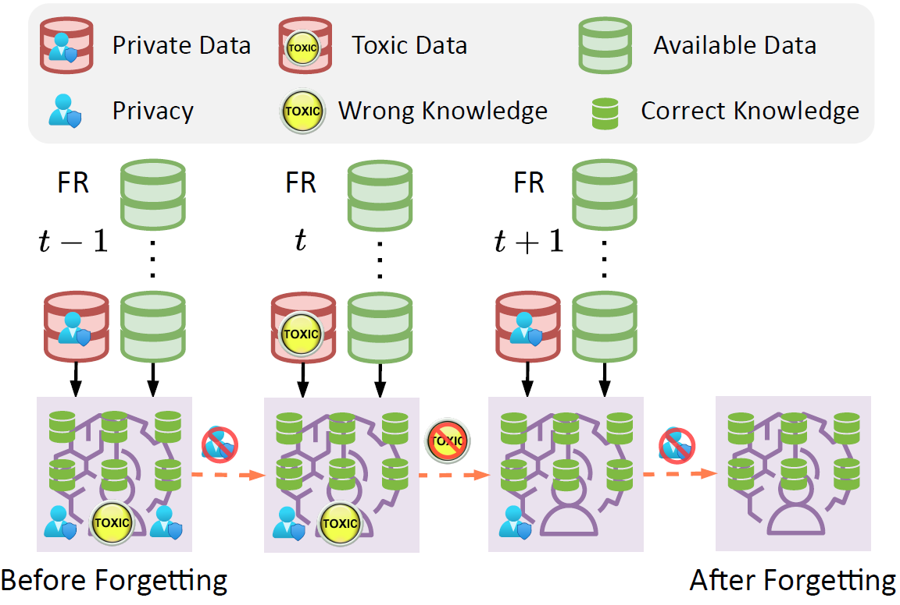
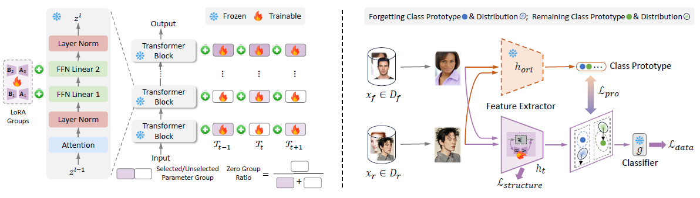

# Practical Continual Forgetting for Pre-trained Vision Models (CVPR 2024; T-PAMI 2026)

[**Project page**](https://bjzhb666.github.io/GS-LoRA/) &nbsp;|&nbsp; [**T-PAMI paper**](https://arxiv.org/abs/2501.09705) &nbsp;|&nbsp; [**CVPR paper**](https://arxiv.org/abs/2403.11530) &nbsp;|&nbsp; [**Video**](https://www.youtube.com/watch?v=yigUY5v1Rgc)



This is the official implementation of ***GS-LoRA*** (CVPR 2024). GS-LoRA is effective, parameter-efficient, data-efficient, and easy to implement continual forgetting, where selective information is expected to be *continuously* removed from a pre-trained model while maintaining the rest. The core idea is to use LoRA combining *group* *Lasso* to realize fast model editing. For more details, please refer to:

**Continual Forgetting for Pre-trained Vision Models [[paper](https://arxiv.org/abs/2403.11530)] [[video](https://www.youtube.com/watch?v=yigUY5v1Rgc)] [[video in bilibili](https://www.bilibili.com/video/BV1wi421C7PQ/?share_source=copy_web&vd_source=7bb418d0ef24f46374712edc865ed254)]**

[‪Hongbo Zhao](https://scholar.google.com/citations?user=Gs22F0UAAAAJ&hl=zh-CN), Bolin Ni, [‪Junsong Fan‬](https://scholar.google.com/citations?user=AfK4UcUAAAAJ&hl=zh-CN&oi=sra), [‪Yuxi Wang‬](https://scholar.google.com/citations?user=waLCodcAAAAJ&hl=zh-CN&oi=sra), [‪Yuntao Chen‬](https://scholar.google.com/citations?hl=zh-CN&user=iLOoUqIAAAAJ), [‪Gaofeng Meng](https://scholar.google.com/citations?hl=zh-CN&user=5hti_r0AAAAJ), [‪Zhaoxiang Zhang‬](https://scholar.google.com/citations?hl=zh-CN&user=qxWfV6cAAAAJ)

**Practical Continual Forgetting for Pre-trained Vision Models (**T-PAMI 2026**, where we consider more practical scenarios including few-shot settings and missing class settings) [[paper](https://arxiv.org/pdf/2501.09705)]**

[‪Hongbo Zhao](https://scholar.google.com/citations?user=Gs22F0UAAAAJ&hl=zh-CN), [Fei Zhu](https://impression2805.github.io/), Bolin Ni, [Feng Zhu](https://zhufengx.github.io/), [‪Gaofeng Meng](https://scholar.google.com/citations?hl=zh-CN&user=5hti_r0AAAAJ), [‪Zhaoxiang Zhang‬](https://scholar.google.com/citations?hl=zh-CN&user=qxWfV6cAAAAJ)

## Method



We incorporate a set of LoRA modules in each continual forgetting task and propose a sparse structure selection strategy and prototype regularization to achieve accurate and few modifications. (Left) All LoRA modules are added in the Linear layers of FFN in the Transformer blocks and we regard the LoRA modules in a
Transformer block as one group. We use group sparse regularization ( $\mathcal{L}_{structure}$ ) to automatically select LoRA groups. The purple groups are selected to modify and the white groups are neglected. The pre-trained model (including Transformer blocks and other parts) is frozen and only LoRA groups are trainable. (Right) To achieve selective forgetting, we utilize selective forgetting and knowledge retention ( $\mathcal{L}_{data}$ ). To further extend our method to more practical scenarios, we introduce
prototype regularization $\mathcal{L}_{pro}$. We use the original model to calculate the prototype of each class and pull away logits from its original prototype for each forgotten class and pull in logits from its own prototype for the remaining classes.

## Getting Started

### Installation

```bash
git clone https://github.com/bjzhb666/GS-LoRA.git
cd GS-LoRA

# with uv (recommended)
uv venv .venv --python 3.10
uv pip install --python .venv/bin/python -e '.[dev]'

# or with conda + pip
conda create -n GSlora python=3.10 && conda activate GSlora
pip install -e '.[dev]'
```

Experiment tracking with Weights & Biases is **optional** (`pip install -e '.[wandb]'`,
then `--tracker wandb`). By default metrics are appended to
`<outdir>/metrics.jsonl`, so a run never fails because wandb is unavailable.

> **CUDA note.** `torch>=2.4` from PyPI ships CUDA 12 kernels and needs a
> driver ≥ 525. On an older driver (e.g. CUDA 11.8) install a matching build,
> e.g. `pip install torch==2.4.1 --index-url https://download.pytorch.org/whl/cu118`.
> Everything except training runs fine on CPU.

### Verify the install

```bash
.venv/bin/python -m pytest -q      # 156 tests, ~40 s, no dataset needed
```

### Prepare the datasets

#### CASIA-100

```bash
mkdir -p data && cd data && unzip data.zip
```

Get CASIA-100 from [this link](https://drive.google.com/file/d/16CaYf45UsHPff1smxkCXaHE8tZo4wTPv/view?usp=sharing) and put it in `data/`. CASIA-100 is a subset of [CASIA-WebFace](https://paperswithcode.com/dataset/casia-webface); the train/test split is already done.

#### ImageNet-100

From [Kaggle](https://www.kaggle.com/datasets/ambityga/imagenet100), then rename the folders — see [issue #4](https://github.com/bjzhb666/GS-LoRA/issues/4#issuecomment-2621800559).
`imagenet_classes.txt` comes from [pytorch/hub](https://github.com/pytorch/hub/blob/master/imagenet_classes.txt);
`imagenet_folder_names.txt` (the canonical 1000-class folder order) is on our
[modelscope link](https://www.modelscope.cn/datasets/zhaohongbo/GS-LoRA-imagenet100) — **use it**, it has metadata fixes.

#### Layout

```
data/
├── faces_webface_112x112_sub100_train_test/
│   ├── train/
│   └── test/
└── imagenet100/
    ├── imagenet_classes.txt
    ├── imagenet_class_index.json
    ├── imagenet_folder_names.txt
    ├── train/
    ├── test/
    └── imagenet_val_missing/      # optional, see below
```

`imagenet_val_missing/` is optional. If present, it should hold validation
images for ImageNet-1k classes that are **not** among the 100, one folder per
class named with its WordNet id. When it exists, an ImageNet run additionally
reports accuracy on those held-out classes before and after each forgetting
task, which measures how much editing the 100 classes disturbs the other 900.

### Repository layout

```
gslora/
├── config.py        one typed Config shared by every entry point
├── losses.py        L_data, L_structure, L_pro and the baseline terms
├── lora_utils.py    LoRA grouping, group norms, re-initialisation
├── prototypes.py    class prototypes for GS-LoRA++
├── data/            class splits, few-shot sampling, dataloaders
├── models/          ViT_face, ViTs_face, torchvision ViT-B/16, heads
├── engine/          the GS-LoRA step, evaluation, batch pairing
├── methods/         LIRF, SCRUB, LwF, DER/DER++, FDR, EWC/MAS/L2, retrain
└── tools/           train_forget.py, pretrain.py, evaluate.py
tests/               156 tests, no dataset required
scripts/             ready-made experiment configurations
docs/                project page (GitHub Pages source)
```

## Pre-train a Face Transformer

Use our [pre-trained Face Transformer](https://drive.google.com/file/d/1Qqeb8fx2_kLeGA1uuLzutpauvyqY3CSV/view?usp=drive_link) and drop it in `results/`, **or** train your own:

```bash
bash scripts/pretrain.sh                       # DEPTH=6 by default
# or directly:
python -m gslora.tools.pretrain -d casia100 -n VIT -head CosFace \
    -w 0 -b 480 -e 1200 --vit_depth 6 --lora_rank 0 \
    --lr 3e-4 --warmup-epochs 10 --decay-epochs 150 \
    --outdir ./results/ViT-P8S8_casia100_cosface_depth6
```

Check a checkpoint (overall + per-class accuracy):

```bash
bash scripts/evaluate.sh results/.../Backbone_VIT_..._checkpoint.pth
```

## Forgetting

Everything goes through **one** entry point; the setting is a flag:

| setting | flag |
|---|---|
| single-step forgetting | `--num_tasks 1` |
| continual forgetting | `--num_tasks 9` |
| few-shot | `--few_shot --few_shot_num 4` |
| missing-class ("open") | `--open_cls_num 10` |
| method | `--method {gslora,retrain,l2,ewc,mas,lirf,scrub,lwf,der,fdr}` |

```bash
# GS-LoRA, single step, CASIA-100
python -m gslora.tools.train_forget \
    -d casia100 -n VIT -head CosFace -w 0 -b 48 \
    -r results/ViT-P8S8_casia100_cosface_depth6/Backbone_VIT_..._checkpoint.pth \
    --method gslora --num_tasks 1 --num_of_first_cls 90 --per_forget_cls 10 \
    --lora_rank 8 --grouping block --data_ratio 0.1 \
    -e 100 --lr 1e-2 --BND 110 --beta 0.05 --alpha 0.005 \
    --outdir ./exps/gslora
```

Ready-made configurations:

```bash
bash scripts/forget_casia.sh gslora       # single-step GS-LoRA
bash scripts/forget_casia.sh gslora++     # few-shot + prototype regularisation
bash scripts/forget_casia.sh cl           # 9-task continual
bash scripts/forget_casia.sh cl-fewshot   # 9-task few-shot GS-LoRA++
bash scripts/forget_casia.sh open         # missing-class setting
bash scripts/forget_casia.sh ewc          # ...and l2 / mas / lwf / der / fdr / scrub / lirf / retrain

bash scripts/forget_imagenet.sh gslora    # ImageNet-100 on ViT-B/16
```

Each run writes to `--outdir`:

```
config.json                 the resolved configuration
metrics.jsonl               every logged metric
Backbone_*_checkpoint.pth   best-H-mean checkpoints (--keep_checkpoints)
task-level/Backbone_task_N.pth
```

Full flag list: `python -m gslora.tools.train_forget --help`.

## Citation

If you find this project useful in your research, please consider citing:

```
@inproceedings{zhao2024continual,
  title={Continual Forgetting for Pre-trained Vision Models},
  author={Zhao, Hongbo and Ni, Bolin and Wang, Haochen and Fan, Junsong and Zhu, Fei and Wang, Yuxi and Chen, Yuntao and Meng, Gaofeng and Zhang, Zhaoxiang},
  booktitle={CVPR},
  year={2024}
}

@article{zhao2025practical,
  title={Practical Continual Forgetting for Pre-trained Vision Models},
  author={Zhao, Hongbo and Zhu, Fei and Ni, Bolin and Zhu, Feng and Meng, Gaofeng and Zhang, Zhaoxiang},
  journal={IEEE Transactions on Pattern Analysis and Machine Intelligence},
  year={2026}
}

```

## Contact

Please contact us or post an issue if you have any questions.

## Acknowledgement

This work is built upon the [zhongyy/Face-Transformer: Face Transformer for Recognition (github.com)](https://github.com/zhongyy/Face-Transformer)

## License

This project is released under the [MIT License](https://github.com/bjzhb666/GS-LoRA/blob/master/LICENSE).
